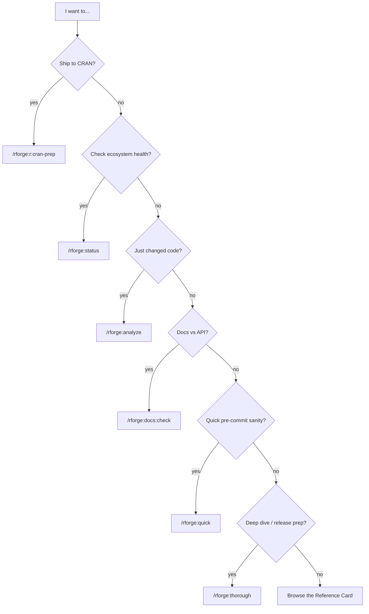
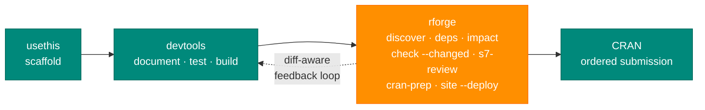

# RForge Plugin

[](https://github.com/Data-Wise/rforge/releases)
[](https://github.com/Data-Wise/rforge/blob/main/LICENSE)
[](https://github.com/Data-Wise/rforge/actions/workflows/ci.yml)

**R package ecosystem orchestrator for Claude Code — {{ rforge.command_count }} commands, R-aware hooks, validation skills.**

⏱️ **5 minutes** • 🟢 Beginner • ✓ 3 steps (install, restart, first command)

!!! tip "TL;DR (30 seconds)"
    - **What:** R package *ecosystem* analysis from inside Claude Code. {{ rforge.command_count }} slash commands.
    - **Why:** Fast feedback on multi-package R repos: discovery, dependencies, change impact, CRAN cascade planning.
    - **How:** `/plugin install rforge` (or `brew install data-wise/tap/rforge`), then `/rforge:analyze "<what changed>"`.
    - **Next:** pick a card in [What do you want to do?](#what-do-you-want-to-do) or follow the [Quick Start](quickstart.md).

## 🎯 What do you want to do?

<div class="grid cards" markdown>

-   :material-rocket-launch: **Get it running**

    ---
    Install and run your first command in 5 minutes.

    [:octicons-arrow-right-24: Quick Start](quickstart.md)

-   :material-flash: **Check my package before a commit**

    ---
    `/rforge:quick` returns in under 10 seconds.

    [:octicons-arrow-right-24: Basic usage](quickstart.md#basic-usage)

-   :material-magnify-scan: **See what my change affects**

    ---
    `/rforge:analyze "<change>"` shows impact and next steps.

    [:octicons-arrow-right-24: Ecosystem analysis](guides/ecosystem-analysis.md)

-   :material-package-up: **Get ready for CRAN**

    ---
    `/rforge:r:cran-prep` runs the full submission gate.

    [:octicons-arrow-right-24: CRAN prep](tutorials/cran-release-prep.md)

-   :material-file-document-check: **Check my docs still match the code**

    ---
    `/rforge:docs:check` audits README and vignette calls.

    [:octicons-arrow-right-24: Docs audit guide](guides/docs-audit.md)

-   :material-school: **Learn step by step**

    ---
    A guided 10-minute walkthrough with a package of your own.

    [:octicons-arrow-right-24: Getting started](tutorials/getting-started.md)

</div>

## 🧭 Which command should I run?



Not sure yet? Start with `/rforge:quick`, then see the [Reference Card](REFCARD.md) for all {{ rforge.command_count }} commands.

## ⚡ What you'll run daily

Most work runs through these four; the rest of the {{ rforge.command_count }} commands are specialized.

<div class="grid cards" markdown>

-   :material-flash: **`/rforge:quick`** · <10s

    ---
    Ultra-fast snapshot. Run before every commit.

-   :material-magnify-scan: **`/rforge:analyze "<change>"`** · ~30s

    ---
    Balanced analysis with impact + recommendations after a change.

-   :material-clipboard-check: **`/rforge:r:cran-prep`** · per-pkg

    ---
    The full CRAN gate; document → strict check → Tier 4 → revdep; writes `cran-comments.md`.

-   :material-layers-triple: **`/rforge:thorough`** · 2-5 min

    ---
    Cross-package ecosystem rollup + submission order.

</div>

## 🔌 Where rforge fits



!!! abstract "rforge orchestrates your ecosystem and automates your build cycle"
    **usethis/devtools build one package. rforge automates the whole ecosystem.** rforge
    wraps the standard R toolchain; it doesn't replace it.

    - **`usethis` / `devtools`** scaffold, document, test, and build a *single* package.
    - **rforge** wraps those same tools at the ecosystem level: `r:cycle` runs document → test → check across any package in your workspace, `r:check --changed` scopes to what you edited, `r:cran-prep` runs the multi-pass CRAN gate, and `r:build` builds the binary.
    - rforge also answers the cross-cutting questions usethis/devtools can't: *Which packages exist here? What depends on what? If I change `medfit`, what breaks downstream? In what order do I submit to CRAN?*

## 📦 Installation

```text
/plugin marketplace add Data-Wise/rforge
/plugin install rforge
```

Restart Claude Code so the commands register, then verify with `/help` (look for `/rforge:` entries). Homebrew and from-source options are in [Installation](installation.md).

### Requirements

| Requirement | Needed for |
|---|---|
| **Claude Code CLI** | everything (this is a Claude Code plugin) |
| **Python 3.10+** on PATH | the `lib/` modules (`discovery`, `deps`, `status`, `init`) |
| **R 4.0+** (+ optional engines via `lib.rcmd`) | all `r:*` commands and `/rforge:thorough` |

!!! warning "Using Codex?"
    This install is for Claude Code only and does not add the Codex skills. See the [Codex installation and checks guide](guides/codex-checks.md).

!!! note "Migrating from v1.2.x?"
    If `~/.claude/settings.json` still has an `mcpServers.rforge` entry, it's no longer needed; remove it. See the [migration guide](migration/rforge-mcp-deprecation.md).

## 🆕 What's new in {{ rforge.version }}

- 🧠 **ADHD-friendly documentation site.** A documented [design system](reference/adhd-design-system.md), regrouped navigation, a "What do you want to do?" home page with a 5-minute [quickstart](quickstart.md) path, and a TL;DR, time line and next-step block on tutorials, guides and top-level pages. Docs-only: no command or flag changes.

??? note "From 2.23.0"
    - 🌐 **`/rforge:docs:check --site` audits Quarto articles and pkgdown development-mode sites.** `--site` must equal the source `url` plus the development prefix. A complete site stage proves route presence only; content freshness and deploy layout are reported as unverified. See the [Docs audit guide](guides/docs-audit.md).

??? note "From 2.20.1"
    - 🐛 **`.STATUS` parsing fixes** — `lib.status` (behind `/rforge:status` and `/rforge:health`)
      reads the `key: value` frontmatter dialect every mediationverse package uses, and takes
      `phase` only from a `phase:` key, not from old history lines in the prose.
    - 🐛 **`/rforge:restore` NEWS count** — entries grouped under `##` subsections are counted again.
    - 📚 **MediationVerse doctrine** in the [CRAN submission](guides/cran-submission.md),
      [dev cycle](guides/dev-cycle.md) and [S7 review](guides/s7-review.md) guides.

??? note "From 2.20.0"
    - 🔖 **`/rforge:restore` + `/rforge:finish`** — R-package session-boundary commands: recap a
      single package's state (DESCRIPTION/NEWS.md/git/`.STATUS`) and sync `.STATUS` from what
      actually happened, dry-run by default with a redundant-edit guard and a version-drift check
      against DESCRIPTION. See the [session boundary guide](guides/session-boundary.md).
    - 🛡️ Backed by a new `lib/rstatus.py` reader/differ, with an `apply_updates()` helper closing
      a data-loss trap (a bare `RStatus(...)` construction silently defaulted every untouched
      field to `None`) found in a 4-agent adversarial review before merge.

Full release history: [CHANGELOG.md](https://github.com/Data-Wise/rforge/blob/main/CHANGELOG.md).

## 🔍 Optional documentation checks

`/rforge:docs:check` keeps its static, offline default. Use `--site URL --ref REF`
for a bounded sitemap comparison against a local source ref, or `--run-examples`
for partial README replay. Execution runs package code and needs a host lifetime
longer than the example budget plus 15 seconds; use the terminal when that limit
is unknown. A2 discrepancies are warnings, while incomplete coverage exits 2
with either enabled severity gate. See the [Docs audit guide](guides/docs-audit.md).

## 🛠️ Under the hood

??? note "Codex personal plugin"
    The source `rforge-openai` adapter 0.2.0 provides three skills:
    `$rforge-check` for package validation, `$rforge-docs-check` for static
    README/vignette API audits, and `$rforge-lint` for CI-aware package lint.
    All reuse the existing Rforge engines. Package/docs skills were verified in
    fresh sessions on isolated medfit copies; the new lint skill still needs
    installation and fresh-session discovery. The original adapter was integrated
    on `dev`
    ([PR #92](https://github.com/Data-Wise/rforge/pull/92)); it is not a published
    adapter release or a port of the Claude command catalog and hooks.

    Start with the [Codex installation and checks guide](guides/codex-checks.md). Claude
    marketplace and Homebrew installation above do not install these Codex skills.

??? note "How it works"
    Since v1.3.0 the plugin is fully self-sufficient: pure-Python `lib/` modules handle discovery, dependencies, status, and init. **No MCP server, no Node.js** at runtime. The fast ecosystem commands (analysis, deps, status) are pure Python; the `r:*` dev-cycle commands and `/rforge:thorough` shell out to R via `lib/rcmd.py`.

    ```text
    You invoke /rforge:<command>
        ↓
    Claude reads commands/<name>.md as its prompt
        ↓
    Claude orchestrates pure-Python lib/ modules + Bash tools as needed
        ├── python3 -m lib.discovery   (ecosystem + package detection)
        ├── python3 -m lib.deps        (dependency graph + change impact)
        ├── python3 -m lib.status      (health snapshot)
        └── python3 -m lib.init        (~/.rforge/context.json setup)
        ↓
    PreToolUse hook diagnoses risky Write/Edit ops (blocks man/*.Rd edits, etc.)
        ↓
    Validation skills run autonomously (description-sync, etc.)
        ↓
    Results synthesized into an actionable summary
    ```

??? note "Design principles (ADHD-friendly)"
    1. **Fast feedback** — `/rforge:quick` returns in seconds, not minutes.
    2. **Clear structure** — consistent, scannable output across commands.
    3. **Visual progress** — you see what's happening as it happens.
    4. **Always actionable** — every result ends with next steps.
    5. **Interruptible & incremental** — results stream as they complete.

## 📚 More documentation

- **[Reference Card](REFCARD.md)** — all {{ rforge.command_count }} commands on one page
- **[Quick-Reference Cards](command-cards.md)** — commands grouped by purpose
- **[Commands](commands.md)** — full per-command reference
- **[Ecosystem orchestration](tutorials/ecosystem-orchestration.md)** — managing several packages at once
- **[rforge in the R lifecycle](tutorials/rforge-in-the-r-lifecycle.md)** — how it fits with devtools and usethis
- **[Glossary](glossary.md)** — terminology explained
- **[Architecture](architecture.md)** — how the `lib/` modules fit together
- **[Hooks & Skills](hooks-and-skills.md)** — the R-aware `PreToolUse` hook
- **[Configuration](configuration.md)** — CRAN mirror, vignette engine, R version pin, CLAUDE.md budget
- **[Troubleshooting](troubleshooting.md)** — when commands misbehave
- **[Contributing](contributing.md)** — how to help improve rforge
- **[Changelog](changelog.md)** — version history

## 📄 License

MIT. Source: <https://github.com/Data-Wise/rforge>
